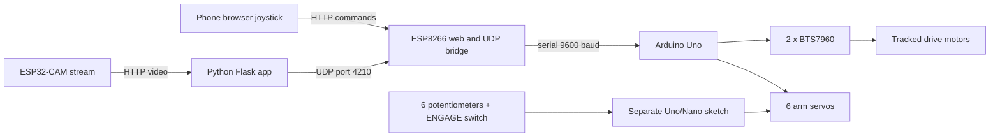

# Mushak Rover

**A tracked rover with Wi-Fi control, a camera-assisted laptop app, and a six-servo arm.**

  

**Maker Challenge 2026** · Krishna and Digvij · Carmel PU College, Modankap · Team Krishna & Digvij · Documentation link deadline: 10 November 2026 · Demo: 15 November 2026 at CFAL Campus, Akashbhavan, Mangalore

Demo video: [mushak-rover-demo.mp4](media/videos/mushak-rover-demo.mp4).

## Contents

- [1. Project Title](#1-project-title)
- [2. Brief Description / Objective](#2-brief-description--objective)
- [3. List of Materials and Components](#3-list-of-materials-and-components)
- [4. Step-by-Step Build Process](#4-step-by-step-build-process)
- [5. Working Explanation / Code](#5-working-explanation--code)
- [6. Final Outcome Photos / Demonstration Video](#6-final-outcome-photos--demonstration-video)
- [7. Learnings and Challenges Faced](#7-learnings-and-challenges-faced)

## 1. Project Title

Mushak Rover — tracked mobile robot with remote drive control and a six-servo arm.

## 2. Brief Description / Objective

The implemented project is a tracked rover driven by an Arduino Uno and two BTS7960 motor drivers. An ESP8266 provides a phone-accessible joystick page and forwards Wi-Fi/UDP commands to the Uno. A separate Python/Flask laptop application provides manual driving, an ESP32-CAM stream view, person-following integration through an unavailable `follow_me.py`, taught arm poses and actions, and CSV event logging. A separate Arduino sketch reads six potentiometers to control six arm servos through an ENGAGE switch.

The code and supplied materials do not establish autonomous navigation, mapping, ROS 2, LiDAR, GPS, or thermal sensing in the built prototype. Those remain planned vision (see [Vision and Future Scope](#vision-and-future-scope)). The phone-control arm is driven through the bridge; the potentiometer controller is a separate configuration.

## 3. List of Materials and Components

| Component evidenced by source files | Notes |
|---|---|
| Tracked chassis, DC motors | Track and motor count/model beyond the firmware comments: TODO |
| Arduino Uno | Main rover controller; a second Uno/Nano is described for the separate pot controller |
| ESP8266 board | Wi-Fi page and UDP-to-serial bridge |
| 2 BTS7960 motor drivers | Left/right drive outputs |
| Six servos and arm | Arm labelled SHURTHI MK-01 in synopsis; exact servo models: TODO |
| ESP32-CAM | Laptop app's camera stream source; camera firmware/model details: TODO |
| Six potentiometers, ENGAGE switch | Separate wired arm-controller sketch |
| 6 V buck converter, fuse, 1000 µF capacitor | Power guidance in pot-controller comments; ratings/part numbers: TODO |
| USB power for Arduino; common ground | As specified in pot-controller sketch |
| Laptop and phone; Wi-Fi access point | For the Python app and ESP8266 control page |

Quantities beyond those explicit in source, prices, chassis materials, battery, tools, and exact wiring connectors are not documented. See [bill of materials](docs/bill_of_materials.md) and [MISSING_INFO.md](docs/MISSING_INFO.md).

## 4. Step-by-Step Build Process

The source material gives development stages but not a verified assembly record. This is a source-grounded outline, not a claim that each step or test was completed in this order:

1. Assemble the tracked base, motors, and arm mounting structure. Exact mechanical details: TODO.
2. Wire the two BTS7960 modules to the Uno pins listed in [wiring](docs/wiring.md); keep high-current motor power appropriately separated from logic wiring.
3. Connect the ESP8266 serial bridge and configure the user's Wi-Fi credentials and network addresses.
4. Connect the six servo signal wires. Use a separate suitable 6 V servo supply and common ground; do not power servos from the Uno 5 V pin.
5. Upload and test the Uno motor/serial firmware with wheels raised, then test the ESP8266 phone page and UDP link.
6. Configure and run the laptop application with the ESP32-CAM stream and external `follow_me.py` dependency.
7. For the standalone wired arm configuration, wire six potentiometers and the ENGAGE switch as documented in its sketch; align the controls before engaging.

See [build process](docs/build_process.md). Assembly photos were not supplied; add real photos when available.

## 5. Working Explanation / Code

### Architecture

See the detailed [architecture and data flow](docs/architecture.md).

### Wiring summary

Uno motor PWM pins are 5, 6, 3, and 11; servo signals use 2, 4, 7, 8, 9, 10. ESP8266 software serial uses GPIO14 (RX) and GPIO12 (TX); the sketch comments describe the Uno-to-ESP8266 return line as optional and level shifted. For the separate pot controller, inputs are A0–A5 and ENGAGE is D12. Consult [wiring tables](docs/wiring.md) before assembly.

### Command protocol

`D,<left>,<right>` drives the two sides (`-255..255`); `A,<channel>,<angle>` sets servo channel 0–5; `S` stops drive; `H` is a heartbeat. Uno firmware stops the motors after 500 ms without a received command. Laptop UDP destination port is 4210. Full details: [protocol](docs/protocol.md).

### Flashing and running

1. Open each `.ino` from its matching sketch-name folder in Arduino IDE, select the correct board/port, and upload: [Uno rover](firmware/rover_uno/mushak_uno2/mushak_uno2.ino), [ESP8266 bridge](firmware/wifi_bridge_esp8266/mushak_esp8266_control2/mushak_esp8266_control2.ino), or [standalone arm controller](firmware/arm_pot_controller/arm_pots_direct/arm_pots_direct.ino). Install the board packages and libraries appropriate to your boards; exact versions are TODO.
2. Replace `YOUR_WIFI_SSID` and `YOUR_WIFI_PASSWORD` in the ESP8266 sketch. Set `ROVER_IP`, `CAM_URL`, `USER`, and `PASSWORD` in the Python app to your own network and credentials. These values are intentionally placeholders; never publish real credentials or private network addresses.
3. In `software/control_app`, create a Python environment and install `requirements.txt`, then run `python mushak_appAK.py`. Install `follow_me.py` alongside it; that file was not supplied, so person-following cannot run from this repository alone. Details: [control app README](software/control_app/README.md).

### Control modes

- **Phone page:** ESP8266 serves a joystick, speed slider, six arm sliders, and STOP over HTTP on the local network.
- **Laptop app:** Flask interface provides manual driving, video display, event log download, arm teaching, and one-button pose sequences.
- **Follow-me:** app code calls YOLO person detection and `follow_me.py` functions for stream handling, target selection, and drive calculation. Dependency absent; behavior cannot be independently reproduced here.
- **Taught arm poses:** app saves named angles locally to `arm_poses.json` and interpolates actions.
- **Pot controller:** independent Arduino sketch maps six pots to six servos; it is not integrated with the Wi-Fi bridge.

### Safety features

The Uno firmware has a 500 ms command-loss motor stop; the phone page has a STOP button; the laptop app implements STOP and starts with its drive enable off. The pot controller uses an ENGAGE switch and comments require a fused 6 V servo supply with 1000 µF capacitor and common ground. The laptop source has `SEND = True` despite its header comment saying false by default; understand and review this before running. These are code features and wiring guidance, not a claim of a certified safety system. See [safety notes](docs/safety.md) and [code notes](docs/CODE_NOTES.md).

## 6. Final Outcome Photos / Demonstration Video

The supplied demo video is included at [media/videos/mushak-rover-demo.mp4](media/videos/mushak-rover-demo.mp4). No separate still photos were supplied. Add verified assembly and outcome photos under `media/images/` when available; do not use illustrative images as build evidence.

## 7. Learnings and Challenges Faced

The source code shows several control layers: a simple line-based serial protocol, Wi-Fi/UDP bridging, a browser interface, a laptop web application, and an independent potentiometer arm controller. It also shows design concerns such as communication-loss stopping, gradual servo motion, and keeping high-current servo power separate from the microcontroller supply. A first-hand account of challenges, changes during assembly, and lessons learned was not included in the supplied material and remains TODO. See [learnings and challenges](docs/learnings_and_challenges.md).

## Vision and Future Scope

The synopsis proposes a broader mobile-manipulation platform with ROS 2, SLAM, Nav2, LiDAR/depth sensing, GPS, IMU, thermal imaging, sensor fusion, and possible disaster-response, industrial, mining, agriculture, and environmental-monitoring roles. These are aspirations in the synopsis, not verified capabilities of the provided implementation. Future work could investigate those ideas after documenting and testing the current prototype.

## Repository Structure

- `firmware/` — three Arduino sketches, each in an Arduino-compatible matching folder.
- `software/control_app/` — Flask control application and dependency notes.
- `docs/` — build, wiring, protocol, safety, testing, and missing-information details.
- `media/videos/` — supplied demo clip; `media/images/` is ready for original photographs.
- `synopsis/` — supplied project vision PDF.

## Replicating the Build

Start with [build process](docs/build_process.md), review [wiring](docs/wiring.md) and [safety](docs/safety.md), then fill every relevant item in [MISSING_INFO.md](docs/MISSING_INFO.md). Set local credentials and network addresses before use. The missing `follow_me.py`, unspecified hardware details, and missing assembly photos limit complete replication.

## Credits

Project authors: Krishna and Digvij, Carmel PU College, Modankap. Synopsis and source files were supplied by the project team.

## Licence

MIT License. Copyright (c) 2026 Krishna and Digvij. See [LICENSE](LICENSE).
