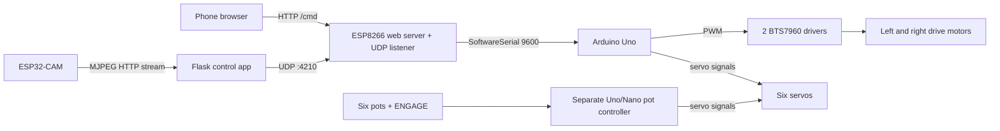

# System architecture

The code implements two ways to issue drive/arm commands through the ESP8266 bridge: a phone browser on the bridge's web page, or a laptop Python app sending UDP datagrams. The ESP8266 forwards commands as newline-terminated serial text to the Uno. The ESP32-CAM is read by the laptop app, not by the Uno sketch. The separate pot controller is an alternate, wired arm-control arrangement and is not connected to this command path.

The laptop app's follow-me path depends on `follow_me.py`, which was not provided. Its calls indicate that the missing module supplies stream reading, YOLO/model constants, person selection, smoothing/timing constants, and drive computation. See [MISSING_INFO.md](MISSING_INFO.md).
